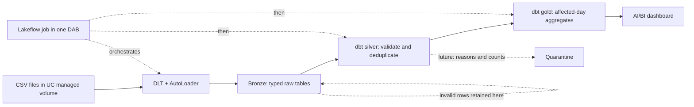

# Solution

## Environment

I used an existing standard Databricks workspace with $400 of promotional credits, serverless compute, and Unity Catalog. Terraform was not needed. A new catalog with default storage required UI setup, so I used the existing managed `workspace` catalog. Development uses `bronze`, `silver`, and `gold`; production uses isolated `bronze_prod`, `silver_prod`, and `gold_prod` schemas.

The production job and DLT pipeline run as `sp-exmox-offer-pipeline`. Initial service-principal creation and grants were performed once and are not fully codified in the bundle.

## Architecture



One DAB deploys the pipeline, job, and dashboard. The job tasks are `ingest_bronze → transform_silver → transform_gold`. I chose one bundle because the stages share deployment variables and do not have independent owners or release cycles.

## How to run

Prerequisites: Databricks CLI authentication and a serverless SQL warehouse. Replace the warehouse ID and workspace host in `databricks.yml` as needed.

```bash
# One-time setup; skip objects that already exist.
databricks schemas create offer_pipeline workspace
databricks volumes create workspace offer_pipeline landing MANAGED

databricks fs mkdir dbfs:/Volumes/workspace/offer_pipeline/landing/installs
databricks fs mkdir dbfs:/Volumes/workspace/offer_pipeline/landing/events
databricks fs mkdir dbfs:/Volumes/workspace/offer_pipeline/landing/offers
databricks fs mkdir dbfs:/Volumes/workspace/offer_pipeline/landing/user_profile

databricks fs cp data/installs.csv dbfs:/Volumes/workspace/offer_pipeline/landing/installs/installs.csv --overwrite
databricks fs cp data/events.csv dbfs:/Volumes/workspace/offer_pipeline/landing/events/events.csv --overwrite
databricks fs cp data/offers.csv dbfs:/Volumes/workspace/offer_pipeline/landing/offers/offers.csv --overwrite
databricks fs cp data/user_profile.csv dbfs:/Volumes/workspace/offer_pipeline/landing/user_profile/user_profile.csv --overwrite

# Deploy and initialize development.
databricks bundle deploy
databricks bundle run bronze_ingestion --full-refresh-all
databricks bundle run offer_pipeline
```

For prod, use `-t prod`. The prod DLT pipeline must be deployed while authenticated as the service principal; job `run_as` alone does not change DLT ownership. The SP needs volume, schema, table, warehouse, workspace-file, and token permissions.

The dashboard is `dashboards/offer_performance.lvdash.json`. Deploying creates/updates it; publish it from the dashboard UI or Lakeview API.

## Metrics and verification

Source timestamps have no timezone and are assumed to be UTC; daily boundaries are derived using that assumption. A short time-of-day analysis did not provide evidence for a different timezone. Installs use `install_ts`; event metrics use `event_ts`, never `ingest_ts`. Country and platform come from the user's install. Reward payouts are deduplicated `reward_paid` events, and reward cost is the sum of their current `offers.payout_eur` values.

Silver applies 34 tests and gold applies 7 tests covering keys, domains, references, timestamp rules, gold-grain uniqueness, and install/reward reconciliation. All passed in the deployed jobs. Repeated runs produced no duplicate rows or changed totals.

| Result | Count/value |
|---|---:|
| Bronze installs / events / offers / profiles | 40,000 / 435,907 / 180 / 40,000 |
| Silver installs / events / offers / profiles | 38,410 / 390,583 / 180 / 38,410 |
| Gold rows | 960 |
| Gold installs | 38,410 |
| Gold reward payouts | 9,419 |
| Gold reward cost | €25,372.29 |

The final prod run also passed with 435,907 bronze events, 390,583 silver events, and 960 gold rows.

## Data findings and decisions

| Finding | Decision |
|---|---|
| 12,721 duplicated event IDs; business fields match, only `ingest_ts` differs | Keep the earliest ingestion and enforce uniqueness in silver. |
| 1,590 noncanonical countries such as `de ` | Drop under the agreed reject-only scope; do not repair. |
| 13,672 raw events reference six unknown offers | Drop through the offer reference rule. None are `reward_paid`, so known reward cost is complete for this input. |
| 3,094 raw events precede their install | Drop; no evidence supports repairing either timestamp. |
| More than 10,900 events arrive over 24 hours late; maximum observed lag is about 134 hours | Preserve timestamps and restate affected gold days. Never shift event time by a fixed lag. |
| Profile lifetime counts and last-seen values often differ from event-derived values | Do not rebuild profiles or use them for gold. Their snapshot semantics are unclear. |
| Blank campaign IDs on organic installs | Valid under the conditional campaign rule, not missing-data errors. |

Invalid rows remain in bronze but are not persisted with rejection reasons. Quarantine is intentionally out of scope; a future parallel dbt branch should materialize rejected rows with source, reasons, and ingestion time. This is important because tests on silver only validate survivors.

No SCD2 was added. Events/installs are facts, profile deletion/recreation semantics are unproven, and a new account need not reuse its user ID. Offer payout history is also unavailable, so historical cost uses the currently supplied payout snapshot.

## Re-runnability and late data

AutoLoader checkpoints prevent repeated file discovery, not event-level duplicates or updates to existing files. Silver events use an incremental merge on `event_id`; small dimension tables are fully refreshed. Gold merges on `(day, country, platform)` and recomputes days affected by new silver load timestamps. Reprocessing the timestamp boundary makes reruns idempotent.

A single gold day can be selected in the gold dbt task with:

```bash
dbt build --select path:models/gold --vars '{"silver_schema":"silver","gold_date":"2026-05-01"}'
```

A 00:15 job that permanently finalizes yesterday is wrong because later arrivals change historical event dates. Instead, every run processes new files and restates their affected event dates. Recent days are provisional, not necessarily wrong. There is no proven fixed finality window; the dashboard colors the observed six-day late-arrival window gray as a heuristic only.

## Platform choices and scale

No manual partitioning was used at this size because it would create small files and country is not a bronze-event attribute. At scale, predictable event month/day partitions can suit historical daily aggregation, while ingestion-date partitions suit arrival-based processing. I would measure bytes/files per partition, skew, pruning, and late rewrite amplification before choosing.

AutoLoader fits file delivery. File notifications improve discovery at scale; replacing existing files still needs a separate reload policy. Kafka/Kinesis becomes useful for lower latency and event-stream replay, but adds operations and does not remove the need for checkpoints, deduplication, or idempotent restatement.

For 50 continuous sources, I would retain the layers, contracts, merges, and affected-day design, but change full refreshes, broad scans, and full-table tests. Add `source_name` to keys/lineage, source-specific watermarks, quarantine and alerts, and versioned schema contracts. Compatible additive changes may proceed; renames, removals, and type changes need review. DLT can run continuously, but the current dbt orchestration is triggered batch.

Unity Catalog governance should use one least-privilege SP per pipeline, analyst `SELECT` primarily on gold, restricted raw/silver access, and centrally managed schemas, grants, volumes, and retention. The data is synthetic, but production `user_id` plus behavioral/device attributes would be pseudonymous rather than anonymous.

## How it can silently produce wrong numbers

- New invalid values are filtered without rejection-count monitoring—for example, a new country outside the contract's accepted set.
- Replaced files, source deletes, or checkpoint resets can produce stale or duplicated input.
- Source deletes/corrections do not remove obsolete gold merge keys.
- Different session timezones can change daily boundaries unless UTC is enforced.
- Reconciliation tests can share the same faulty assumptions as the transformation; passing tests is not proof of complete input.

## How I worked with AI

I used **Kimi K3.1 Pro through OpenRouter in OpenCode**. I sketched the architecture, then worked layer by layer: discuss and challenge the next step, implement it, run it, and inspect the result. Work was sequential rather than parallel. A separate session will be used to challenge the output independently.

I kept the managed-volume/DLT bronze design, dbt transformations/tests, one-DAB orchestration, and the dashboard. I rejected unnecessary DQX/SCD2 complexity, separate bundles per step, current-data partitioning, country repair, and the confidently suggested 72-hour timestamp repair because it confused late arrival with clock skew.

Review caught issues I would not accept blindly: dashboard units first changed invisible labels rather than visible titles, and job `run_as` did not change the DLT owner. The second was found by inspecting `run_as_user_name` and fixed by deploying prod as the SP.
